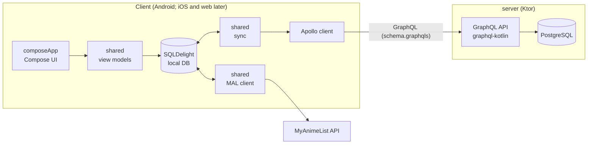

# Anime Tracker (KMP)

[](https://github.com/greenzean/anime-kmp/actions/workflows/ci.yml)

Offline-first anime tracker built with Kotlin Multiplatform and Compose Multiplatform. The app talks to MyAnimeList directly and works without an account; an optional account on a Ktor + PostgreSQL server (GraphQL API) syncs the library between devices. Phase 1 targets Android; iOS and web come later. MVP scope: [`docs/milestone2-mvp.md`](docs/milestone2-mvp.md).

## Modules

- `androidApp/`: Android host (application module, `MainActivity`).
- `composeApp/`: Compose Multiplatform UI library (`commonMain`).
- `shared/`: KMP logic (`commonMain`): data layer, sync, Apollo operations, MAL client, importers, view models.
- `server/`: Ktor server, GraphQL schema/resolvers, Postgres, Flyway.
- `docs/`: ADRs (`docs/decisions/`), MVP scope, tickets, notes.

## Architecture



- **Offline first.** The local database is the source of truth. The UI reads and writes only locally, and sync talks to the server.
- **Only the app talks to MyAnimeList.** MAL tokens stay on each device; the server stores no platform tokens, platform user data or anime metadata, only library entries and anime IDs ([ADR 0007](docs/decisions/0007-client-side-platform-access.md)). The client is still treated as untrusted by our server.
- **The GraphQL schema is the contract.** The server owns it, and the SDL is committed in `shared`. API changes go server first, then the client.
- **Shared logic lives in `commonMain`.** Platform APIs (secure storage, notifications, file picker, connectivity, background work) sit behind interfaces or `expect/actual`.

### Sync

Offline-first: the UI reads and writes only the local SQLDelight database. Changes are queued as pending and pushed by a WorkManager job when the network is available; the client then pulls changes since its cursor. Last-write-wins with tombstones. Details: [ADR 0006](docs/decisions/0006-sync-protocol.md).

### Auth

Not implemented yet. Planned: Google sign-in for the optional server account (the server verifies the Google ID token and issues its own token), and MAL OAuth with PKCE on each device, with tokens kept on the device. For now every request is treated as a single hardcoded dev user, so any install pulls the same library.

### Data model

An ID-only `anime` map (internal id and `mal_id`, no titles) plus per-user `list_entry` rows (status, progress, score) that carry the sync columns (`server_seq`, tombstone). Server schema: Flyway migrations in `server/`; client schema: SQLDelight in `shared/`. Debug builds of the app seed a small local dev catalog of anime titles.

### Decisions

Recorded as ADRs in [`docs/decisions/`](docs/decisions/README.md):

- [0001: AGP 9 module layout](docs/decisions/0001-agp9-module-layout.md)
- [0002: Lint and format tooling](docs/decisions/0002-lint-tooling.md)
- [0003: GraphQL server library](docs/decisions/0003-graphql-server.md)
- [0004: Client/server contract](docs/decisions/0004-shared-contract.md)
- [0005: Postgres access, migrations and test database](docs/decisions/0005-postgres-access.md)
- [0006: Sync protocol](docs/decisions/0006-sync-protocol.md)
- [0007: Client-side platform access](docs/decisions/0007-client-side-platform-access.md)
- [0008: MAL API behaviour and how the app uses it](docs/decisions/0008-mal-api.md)
- [0009: Anime references: a server-side ID map keyed by platform IDs](docs/decisions/0009-anime-id-map.md)
- [0010: Server sign-in and session tokens](docs/decisions/0010-server-sign-in.md)

## Build

```
./gradlew build
```

## Lint and format

```
./gradlew spotlessApply        # format
./gradlew spotlessCheck detekt # what CI runs
./gradlew installGitHooks      # optional pre-commit hook running the checks
```

Spotless (ktlint + Compose rules) handles formatting; detekt handles static analysis. Style settings are in `.editorconfig` and `config/detekt/detekt.yml`.

Copy `.env.example` to `.env` for server configuration. Never commit `.env`.

## Run the server

`scripts/dev-server.sh` starts the Compose Postgres and runs the server against it (`--reset` wipes the database first); `scripts/dev-app.sh` installs the debug app on an emulator pointed at it. Or by hand:

```
./gradlew :server:run
curl localhost:8080/health
curl localhost:8080/graphql -H 'content-type: application/json' -d '{"query":"{ hello }"}'
```

GraphiQL is at <http://localhost:8080/graphiql>. After changing the GraphQL schema, run `./gradlew :server:test -PupdateSchema` and commit the `shared/src/commonMain/graphql/schema.graphqls` diff.

Configured by env vars `HOST`, `PORT`, `APP_ENV` (`dev` | `prod`; `prod` logs JSON) and `LOG_LEVEL`. See `.env.example`.

Google sign-in needs `GOOGLE_CLIENT_ID` (the web/server OAuth client ID) and `JWT_SECRET` (at least 32 bytes, e.g. `openssl rand -base64 48`), and a database. Set both or neither; `APP_ENV=prod` requires them. Without them the server starts and the `signInNonce`, `signInWithGoogle` and `refreshSession` mutations return "Sign-in is not configured".

Gradle does not read `.env`. With `DATABASE_URL`, `DATABASE_USER` and `DATABASE_PASSWORD` exported the server connects to Postgres and runs Flyway migrations on start; without them it starts without a database and the sync API is unavailable.

## Android debug build against a local server

The server URL comes from the `animekmp.serverUrl` Gradle property (default: a placeholder HTTPS URL). For a local server, set it in the gitignored `local.properties` at the repo root (or `~/.gradle/gradle.properties`, or `-P`), e.g. `animekmp.serverUrl=http://10.0.2.2:8080/graphql` (`10.0.2.2` is the emulator's host machine). Android blocks plain HTTP by default, so also create two files that are gitignored (`androidApp/src/debug/`) and never ship in release builds:

- `androidApp/src/debug/AndroidManifest.xml`: a `<manifest>` with `<application android:networkSecurityConfig="@xml/network_security_config" />`
- `androidApp/src/debug/res/xml/network_security_config.xml`: a `<network-security-config>` with a `<domain-config cleartextTrafficPermitted="true">` for the domain `10.0.2.2`

Release builds use the same property and must use HTTPS.

## Local environment (Docker)

Starts PostgreSQL and the server with one command. Needs Docker with Compose v2.

```
cp .env.example .env     # optional: defaults work without it
docker compose up --build
curl localhost:8080/health
```

- The first build takes a few minutes (Gradle downloads dependencies); later builds reuse the cache.
- Postgres listens on `127.0.0.1:5432` (db, user and password default to `animekmp`; override with `POSTGRES_DB`, `POSTGRES_USER`, `POSTGRES_PASSWORD` in `.env`). Data lives in the `postgres-data` volume.
- The server connects to Postgres and runs Flyway migrations on start.
- Stop with `docker compose down`; add `-v` to also delete the database volume.
- To run the server from Gradle against the Compose database: `docker compose up postgres`, then `DATABASE_URL=jdbc:postgresql://localhost:5432/animekmp DATABASE_USER=animekmp DATABASE_PASSWORD=animekmp ./gradlew :server:run`.

## Quick start (emulator)

1. `docker compose up --build -d` and check `curl localhost:8080/health`.
2. Add `animekmp.serverUrl=http://10.0.2.2:8080/graphql` to `local.properties` and create the two debug cleartext files described above.
3. Start an Android emulator and run `./gradlew :androidApp:installDebug`, then open the app.
4. Add an anime (it shows *Pending* and syncs when the network is up, then shows *Synced*). Clear the app data or use a second emulator to see the entry pulled back.

Result of the end-to-end check: [`docs/m1-8-e2e-result.md`](docs/m1-8-e2e-result.md).

## License

MIT, see `LICENSE`.
