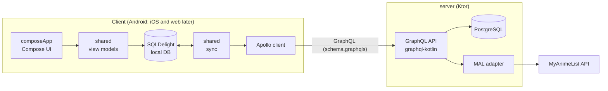

# Anime Tracker (KMP)

[](https://github.com/greenzean/anime-kmp/actions/workflows/ci.yml)

Offline-first anime tracker built with Kotlin Multiplatform and Compose Multiplatform. Anime data comes from MyAnimeList via a Ktor + PostgreSQL server with a GraphQL API. Phase 1 targets Android; iOS and web come later.

## Modules

- `androidApp/`: Android host (application module, `MainActivity`).
- `composeApp/`: Compose Multiplatform UI library (`commonMain`).
- `shared/`: KMP logic (`commonMain`): data layer, sync, Apollo operations, importers, view models.
- `server/`: Ktor server, GraphQL schema/resolvers, Postgres, Flyway, MAL adapter.
- `docs/`: ADRs (`docs/decisions/`), tickets, notes.

## Architecture



- **Offline first.** The local database is the source of truth. The UI reads and writes only locally, and sync talks to the server.
- **Only the server talks to MyAnimeList.** The client is treated as untrusted.
- **The GraphQL schema is the contract.** The server owns it, and the SDL is committed in `shared`. API changes go server first, then the client.
- **Shared logic lives in `commonMain`.** Platform APIs (secure storage, notifications, file picker, connectivity, background work) sit behind interfaces or `expect/actual`.

### Sync

*TBD.*

### Auth

*TBD (MAL OAuth with PKCE, server-issued JWT).*

### Data model

*TBD.*

### Decisions

Recorded as ADRs in [`docs/decisions/`](docs/decisions/README.md):

- [0001: AGP 9 module layout](docs/decisions/0001-agp9-module-layout.md)
- [0002: Lint and format tooling](docs/decisions/0002-lint-tooling.md)
- [0003: GraphQL server library](docs/decisions/0003-graphql-server.md)
- [0004: Client/server contract](docs/decisions/0004-shared-contract.md)
- [0005: Postgres access, migrations and test database](docs/decisions/0005-postgres-access.md)
- [0006: Sync protocol](docs/decisions/0006-sync-protocol.md)

## Build

```
./gradlew build
```

## Lint and format

```
./gradlew spotlessApply        # format
./gradlew spotlessCheck detekt # what CI runs
./gradlew installGitHooks      # optional pre-commit hook running the checks
```

Spotless (ktlint + Compose rules) handles formatting; detekt handles static analysis. Style settings are in `.editorconfig` and `config/detekt/detekt.yml`.

Copy `.env.example` to `.env` for server configuration. Never commit `.env`.

## Run the server

```
./gradlew :server:run
curl localhost:8080/health
curl localhost:8080/graphql -H 'content-type: application/json' -d '{"query":"{ hello }"}'
```

GraphiQL is at <http://localhost:8080/graphiql>. After changing the GraphQL schema, run `./gradlew :server:test -PupdateSchema` and commit the `shared/src/commonMain/graphql/schema.graphqls` diff.

Configured by env vars `HOST`, `PORT`, `APP_ENV` (`dev` | `prod`; `prod` logs JSON) and `LOG_LEVEL`. See `.env.example`.

## Android debug build against a local server

The server URL comes from the `animekmp.serverUrl` Gradle property (default: a placeholder HTTPS URL). For a local server, set it in `~/.gradle/gradle.properties`, e.g. `animekmp.serverUrl=http://10.0.2.2:8080/graphql` (`10.0.2.2` is the emulator's host machine). Android blocks plain HTTP by default, so also create two files that are gitignored (`androidApp/src/debug/`) and never ship in release builds:

- `androidApp/src/debug/AndroidManifest.xml`: a `<manifest>` with `<application android:networkSecurityConfig="@xml/network_security_config" />`
- `androidApp/src/debug/res/xml/network_security_config.xml`: a `<network-security-config>` with a `<domain-config cleartextTrafficPermitted="true">` for the domain `10.0.2.2`

Release builds use the same property and must use HTTPS.

## Local environment (Docker)

Starts PostgreSQL and the server with one command. Needs Docker with Compose v2.

```
cp .env.example .env     # optional: defaults work without it
docker compose up --build
curl localhost:8080/health
```

- The first build takes a few minutes (Gradle downloads dependencies); later builds reuse the cache.
- Postgres listens on `127.0.0.1:5432` (db, user and password default to `animekmp`; override with `POSTGRES_DB`, `POSTGRES_USER`, `POSTGRES_PASSWORD` in `.env`). Data lives in the `postgres-data` volume.
- Compose sets `DATABASE_URL` for the server, so it runs the Flyway migrations against Postgres on startup.
- Stop with `docker compose down`; add `-v` to also delete the database volume.
- To run the server from Gradle against the Compose database: `docker compose up postgres`, then `./gradlew :server:run`.

## License

MIT, see `LICENSE`.
